<!-- BEGIN animated project showcase -->
<picture>
  <source media="(prefers-reduced-motion: reduce) and (max-width: 600px)" srcset=".github/showcase/still-emerald-overview-mobile.svg">
  <source media="(prefers-reduced-motion: reduce)" srcset=".github/showcase/still-emerald-overview.svg">
  <source media="(max-width: 600px)" srcset=".github/showcase/emerald-overview-mobile.svg">
  
</picture>

**Team project:** patient authentication and doctor administration are Rifatur Rahman’s focus. Booking/dashboard contributions are team work. Feature branches and runtime-verification status are described below.
<!-- END animated project showcase -->

# hospital-appointment-system
Full-stack Hospital Appointment Booking System built with PHP, MySQL, HTML, CSS and JavaScript.

## Development

PHP MVC + MySQL implementation for patient authentication, admin doctor/specialization management, patient booking, and doctor/admin appointment dashboards. Developer A owns Students 1–2; Developer B owns Students 3–4. No runtime or database is bundled or automatically installed.

- [Setup and configuration](docs/setup.md)
- [API contracts](docs/api.md)
- [Requirements decisions](docs/requirements-decisions.md)
- [Tests and acceptance matrix](docs/testing.md)
- [Small-commit review plan](docs/commit-plan.md)
- [Developer B handoff](docs/developer-b-handoff.md)

Serve only `public/`. Keep `.env`, audit records, uploads, and credentials out of commits. Booking remains disabled until clinic hours and slot duration are explicitly configured. Use `database/schema.sql` only for a new empty database; never replace a shared schema.

Developer A's seven commits are preserved on `feature/developer-a-foundation` with draft PR #1. Developer B's reviewed booking/dashboard changes are committed separately on `feature/developer-b-appointments`. The requested Developer B draft PR targets `main` and depends on PR #1's foundation. Neither PR is merged. Runtime verification remains pending approved PHP/MySQL availability; static/JavaScript checks are not a substitute.
